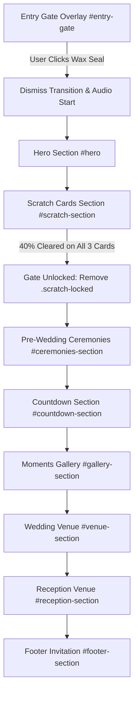

# Architecture & System Blueprint — Wedding Invitation

> **Note for AI Agents & Developers:**  
> Reading this single file provides complete, 100% comprehensive architectural knowledge of this codebase. You do not need to re-read or scan the raw source files (`home.html`, `index.html`, `style.css`, `main.js`) to understand where components live, how states flow, or how to make modifications.

---

## 1. Project Overview & Couple Details

- **Couple:** Sawali (Bride) & Vaibhav (Groom)
- **Primary Wedding Date & Time:** 25 November 2026 at 1:45 PM
- **Key Ceremonies:**
  1. **Engagement (साखरपुडा):** 24 November 2026, 05:00 PM — Akshada Multipurpose Hall, Kaneriwadi, Kolhapur 416234
  2. **Haldi (हळद):** 24 November 2026, 09:00 PM — Akshada Multipurpose Hall, Kaneriwadi, Kolhapur 416234
  3. **Wedding (शुभ विवाह):** 25 November 2026, 1:45 PM — Akshada Multipurpose Hall, Kaneriwadi, Kolhapur 416234
  4. **Reception (स्नेहभोजन):** 02 December 2026 (Wednesday), 7:00 PM Onwards — RJ Celebration, Gorewada Ring Road, Nagpur 440013
- **Primary Live Link / Deployment:** `https://sawaliwedsvaibhav.netlify.app` (Netlify Drop) + GitHub Pages (`NileshGale/wedding_invitation`).

---

## 2. Directory & File Map

```
c:\Users\Lenovo\OneDrive\Desktop\vallari's project/
├── index.html          # Core HTML document & production entry point (complete DOM hierarchy)
├── style.css           # Central stylesheet (Design tokens, 3D envelope, lightning borders, media queries)
├── main.js             # Logic controller (audio compliance, canvas scratch, petals animation, timer, reveals)
├── song.mp3            # Ambient background wedding track (loaded by <audio id="bg-music">)
├── README.md           # User guide and quick reference
├── architecture.md     # This architectural reference specification
├── assets/             # External venue & event photographs
│   ├── venue.jpeg      # Wedding venue photograph (Akshada Multipurpose Hall)
│   └── reception.jpeg  # Reception venue photograph (RJ Celebration, Nagpur)
└── couple_photo/       # High-resolution couple gallery pictures
    ├── photo1.jpeg     # Polaroid 1: "The Beginning ✨"
    ├── photo2.jpeg     # Polaroid 2: "Hand in Hand 🤝"
    ├── photo3.jpeg     # Polaroid 3: "Moments of Love ❤️"
    ├── photo4.jpeg     # Polaroid 4: "Laughter & Joy ✨"
    ├── photo5.jpeg     # Polaroid 5: "Cherished Smiles 🌸" (also used as entry gate blurred background)
    └── photo6.jpeg     # Polaroid 6: "Together Forever ♾️"
```

---

## 3. DOM Component Structure (`index.html`)

The document renders components in the following chronological top-down sequence:



### Detailed Breakdown of Sections:

1. **Ambient Layer:**
   - `<audio id="bg-music" loop src="song.mp3">`: Audio tag controlled via JS.
   - `<canvas id="petals-canvas">`: Fullscreen canvas animating drifting rose petals and gold dust.
   - `<button id="audio-btn">`: Fixed floating glassmorphic toggle in bottom-left.

2. **Entry Gate Overlay (`#entry-gate`):**
   - Fixed `100vw x 100vh`, `z-index: 9999`.
   - `.entry-gate__bg`: Displays `couple_photo/photo5.jpeg` with `filter: blur(12px) brightness(0.4)`.
   - `.envelope-wrapper`: 3D perspective container holding the title `"Tap to Reveal"` and the 3D envelope.
   - `.envelope`: 4-flap maroon envelope with interior card `.envelope__card` (Ganesha SVG + Sawali & Vaibhav).
   - `#open-btn.wax-seal`: Royal wax seal button with couple initials `S` & `V` + heart icon.

3. **Hero Section (`#hero`):**
   - Full-height centered card (`.hero-card`) with ornate golden filigree corners (`.hero-corner`).
   - Pulsing Lord Ganesha SVG icon.
   - Sanskrit quotation: *"वक्रतुण्ड महाकाय सूर्यकोटि समप्रभ। निर्विघ्नं कुरु मे देव सर्वकार्येषु सर्वदा॥"*
   - Main couple heading: `Sawali & Vaibhav` (`.couple-name`).
   - Parents / Bride & Groom indicators (`.parent-sub`).
   - `#scroll-indicator`: Clickable pulsing arrow leading directly to the Scratch section.

4. **Scratch Cards Gate (`#scratch-section`):**
   - Heading: `Save the Date` with `.scratch-subtitle` (*"Scratch below to reveal our wedding date"* — 700 bold).
   - `.scratch-grid`: Holds 3 columns (`Month`, `Day`, `Year`).
   - Each card contains:
     - Hidden value (`.scratch-card__under`): `November` | `25` | `2026`.
     - Scratchable canvas (`.scratch-canvas`): IDs `#scratch-month-canvas`, `#scratch-day-canvas`, `#scratch-year-canvas`.
     - Lightning border SVG overlay (`.lightning-border`): `vector-effect="non-scaling-stroke"` with `pathLength="1000"` driving multi-layered infinite neon beam animation on hover/active.

5. **Pre-Wedding Ceremonies (`#ceremonies-section`):**
   - 2 symmetric cards (`.ceremony-card`):
     - **Engagement Card (`.ceremony-card--engagement`):** Interlocked rings SVG, `24 November 2026 · 05:00 PM`, Akshada Multipurpose Hall, direct Google Maps button.
     - **Haldi Card (`.ceremony-card--haldi`):** Auspicious Kalash SVG, `24 November 2026 · 09:00 PM`, Akshada Multipurpose Hall, turmeric-gold button & styling.

6. **Wedding Countdown Timer (`#countdown-section`):**
   - Glassmorphic card (`.cd-card`) with script tagline, heading `The Wedding`, and date badge `25 November 2026 · 1:45 PM`.
   - `.cd-grid`: 4-column real-time units: `#days`, `#hours`, `#minutes`, `#seconds`.

7. **Polaroid Moments Gallery (`#gallery-section`):**
   - Grid displaying all 6 high-res photos from `couple_photo/`:
     - `photo1.jpeg`: *The Beginning ✨* (`--rot: -2.5deg`)
     - `photo2.jpeg`: *Hand in Hand 🤝* (`--rot: 2deg`)
     - `photo3.jpeg`: *Moments of Love ❤️* (`--rot: -1.5deg`)
     - `photo4.jpeg`: *Laughter & Joy ✨* (`--rot: 2.5deg`)
     - `photo5.jpeg`: *Cherished Smiles 🌸* (`--rot: -2deg`)
     - `photo6.jpeg`: *Together Forever ♾️* (`--rot: 1.5deg`)
   - Styled as authentic Polaroids with translucent tape stickers (`::before`), desktop hover straightening/zoom (`rotate(0deg) scale(1.05)`), and clean mobile styling:
     - **Natural Tilt:** Organic tilt without swaying or forced layout shift.
     - **Scroll Reveal Stability:** Mobile overrides `.reveal { transform: none !important; }` so sections fade in without vertical jumping.
     - **Touch Feedback:** Subtle scale and warm golden glow on touch.

8. **The Wedding Venue (`#venue-section`):**
   - Card (`.venue-card`) displaying `assets/venue.jpeg`.
   - Venue Name: **Akshada Multipurpose Hall**
   - Address: Kaneriwadi, Kolhapur, Maharashtra — 416234
   - Maps link: `https://maps.app.goo.gl/yJzGZ8S9FCQh2c5Y7?g_st=ac`

9. **The Reception (`#reception-section`):**
   - Card (`.venue-card.reception-card`) displaying portrait venue photo `assets/reception.jpeg` (796×1280, framed with `aspect-ratio: 4 / 5`, `max-height: 560px`, and `object-position: center top` to preserve the RJ Celebration golden emblem and floral canopy).
   - Time Badge: `Wednesday, 02 December 2026` + `Evening 07:00 PM Onwards`.
   - Venue Name: **RJ Celebration**
   - Address: Gorewada Ring Road, Nagpur, Maharashtra — 440013
   - Maps link: `https://maps.app.goo.gl/kYtbq9qu1bM61bJ58`

10. **Footer Section (`#footer-section`):**
    - Warm invitation quote, couple name `Sawali & Vaibhav`, *& The Entire Family*, and year credit.

---

## 4. JavaScript Logic & Interaction Architecture (`main.js`)

1. **Browser Scroll Restoration Disabling:**
   - On load, executes:
     ```js
     if ('scrollRestoration' in history) history.scrollRestoration = 'manual';
     window.scrollTo(0, 0);
     ```
     Guarantees the user is never restored to a mid-page scroll offset on refresh.

2. **Envelope Opening & Dismissal Workflow:**
   - User clicks `#open-btn` (wax seal).
   - Envelope receives `.open`: Flap rotates `180deg` via 3D perspective (`transform: rotateX(180deg)`), wax seal fades out.
   - Background audio starts playing via `playMusic()`.
   - At `1400ms`:
     - `#entry-gate` receives `.dismissed` (`transform: translateY(-100%); opacity: 0;`).
     - `body.no-scroll` is removed.
     - View is hard-locked to `#hero` (`window.scrollTo({ top: 0, behavior: 'instant' })`).
     - Falling petals loop initiates.
     - Scroll reveal observer initiates.

3. **Audio Autoplay Compliance System:**
   - Due to strict browser policies (iOS Safari & Chrome), audio cannot autoplay without a user gesture.
   - The wax seal click acts as the verified user interaction that initiates `bgMusic.play()`.
   - Floating button `#audio-btn` toggles play/pause with SVG paths swapping between sound-waves and muted-X icons.

4. **Petals Canvas System (`startPetalsAnimation()`):**
   - Generates 45 organic petal particles using mathematical quadratic curves.
   - Color array: Regal Maroon (`rgba(138, 79, 76, 0.6)`), Rose Gold Pink, and Warm Metallic Gold.
   - Horizontal sway modeled using `Math.sin(swayAngle)` combined with rotation.

5. **Countdown Timer (`updateCountdown()`):**
   - Target timestamp: `const targetDateStr = "November 25, 2026 13:45:00";`
   - Computes difference every 1000ms and updates text content of `#days`, `#hours`, `#minutes`, `#seconds`.

6. **Canvas Scratching Engine (`initScratchCards()`):**
   - Initializes each canvas at its rendered dimensions (`190px x 250px`).
   - Draws a wine-red/rose-gold gradient overlay with gold border and `"S C R A T C H"` text banner.
   - Supports mouse events (`mousedown`, `mousemove`, `mouseup`) and touch events (`touchstart`, `touchmove`, `touchend`) with `touch-action: none; e.preventDefault()` to prevent scrolling while scratching.
   - Clears path using `sCtx.globalCompositeOperation = 'destination-out'` with `arc` radius of 22px.
   - **Performance sampling:** Checks alpha channel on every 16th pixel.
   - **Threshold:** When cleared pixels exceed **40%**, card auto-fades and displays underlying value.
   - **Lock Mechanic:** Once all 3 cards are scratched (`clearedCount === 3`), removes `.scratch-locked` from `#main-content`, instantly unlocking the rest of the invitation.

---

## 5. CSS System & Visual Engine (`style.css`)

### Color Tokens:
- `--primary-color: #8a4f4c;` (Regal Wine Red / Maroon)
- `--primary-dark: #502220;` (Deep envelope shadow maroon)
- `--primary-light: #ba7a76;` (Rose gold pink highlight)
- `--accent-color: #d4af37;` (Metallic Gold)
- `--accent-light: #e8ce73;` (Warm festive champagne gold)
- `--bg-light: #faf5f0;` (Festive Cream paper)
- `--glass-bg: rgba(250, 245, 240, 0.88);`
- `--glass-border: rgba(212, 175, 55, 0.35);`

### Typography:
- Headings & Titles: `'Cormorant Garamond', serif` (Weights: 300, 400, 500, 600, 700, and 700 italic)
- Labels & Body: `'Montserrat', sans-serif` (Weights: 300, 400, 500, 600, 700)

### Infinite Lightning Border Architecture:
- Each scratch card contains an SVG with 4 `<rect>` paths set to `pathLength="1000"`:
  1. `.lightning-track`: Base 2px gold border (`stroke: var(--accent-color)`).
  2. `.lightning-glow`: 4.5px golden radiant aura (`stroke: #d4af37; filter: drop-shadow(...)`).
  3. `.lightning-bolt`: 2.5px white-gold core beam (`stroke: #ffffff; filter: drop-shadow(...)`).
  4. `.lightning-spark`: 4.5px blazing white-hot spark head with electric jitter keyframes.
- Keyframe `@keyframes lightningOrbit`:
  Moves `stroke-dashoffset` from `0` to `-1000` continuously (`animation: lightningOrbit 1.8s linear infinite`).
- Keyframe `@keyframes lightningFlicker`:
  Subtle micro-voltage surge simulating real electrical plasma along the card perimeter.
- Triggers on both desktop `:hover` and mobile/tablet `:active` touch interactions.

---

## 6. Responsive Breakpoint Matrix

| Device Category | Screen Range | Key Adaptations |
|---|---|---|
| **Laptops / Desktops** | `> 1024px` | 3-column scratch cards, 3-column polaroids (2×3 grid), full-size 450px envelope, spacious 650px hero card. |
| **iPads & Tablets** | `768px – 1024px` | Envelope scaled to `0.85 – 0.9`. 3-column scratch cards fit side-by-side. Polaroids arrange into a balanced 2-column grid. |
| **Phablets / Foldables**| `601px – 767px` | Envelope scaled to `0.82`. Polaroids 2-column. Scratch cards switch cleanly if under 640px. |
| **Mobile Phones** | `381px – 600px` | Envelope scaled to `0.72`. Scratch cards arranged in 2-top (Month, Day) + 1-bottom centered (Year) layout (`145px × 195px`). Polaroids 1-column with softened tilt (`calc(var(--rot) * 0.5)`). iOS safe-area insets applied to floating music button. |
| **Compact Phones** | `< 380px` (iPhone SE) | Envelope scaled to `0.6`. Countdown unit fonts reduced to `1.7rem`. Scratch wrapper scaled to `135px × 180px` in 2+1 centered layout. |
| **Landscape Mobile** | `height < 520px` | Envelope scaled to `0.5` with reduced vertical gap so flaps and card remain within viewport bounds. |

---

## 7. Quick Developer Cheat Sheet

- **To update wedding date & time for countdown:**  
  Edit `const targetDateStr` in [`main.js:187`](file:///c:/Users/Lenovo/OneDrive/Desktop/vallari's%20project/main.js#L187).
- **To edit ceremony timings or addresses:**  
  Edit `#ceremonies-section` in [`index.html`](file:///c:/Users/Lenovo/OneDrive/Desktop/vallari's%20project/index.html#L232-L345).
- **To update reception date or venue:**  
  Edit `#reception-section` in [`index.html`](file:///c:/Users/Lenovo/OneDrive/Desktop/vallari's%20project/index.html#L425-L480).
- **To swap photos:**  
  Place new files in `couple_photo/` (named `photo1.jpeg` through `photo6.jpeg`) or `assets/` (`venue.jpeg`, `reception.jpeg`).
- **To deploy updates to the live web link:**  
  Drag and drop the root folder into the **Deploys** tab of the Netlify dashboard (`https://app.netlify.com`).
